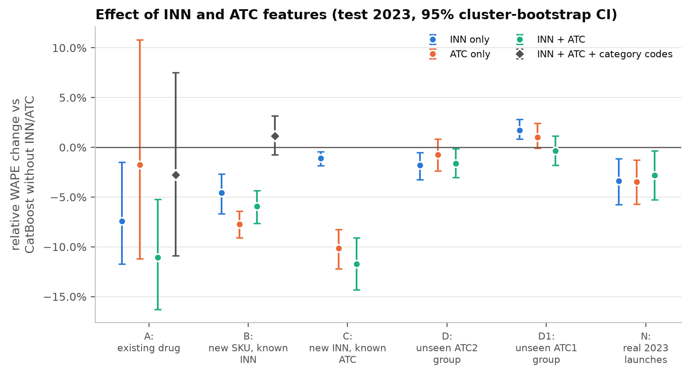

# Teva Pharma Demand Research

Reproducible experiments on forecasting monthly pharmaceutical sales with CatBoost, focused on one question:

> **How much do the INN (active substance) and the ATC classification improve forecasts of drug sales, especially in a cold start, when a new product has no sales history of its own?**

The study uses the public Teva sales dataset (13,762 SKUs, 1,776 INNs plus 931 SKUs without an INN, monthly packs sold 2019-01 … 2023-12) and compares baselines with CatBoost models with and without INN/ATC features in six scenarios: an existing drug, simulated cold starts at the SKU, INN and ATC-group level, and the real product launches of 2023.

## Key results (test year 2023)

Test-year WAPE of CatBoost without and with INN + ATC peer statistics, with the 95% cluster-bootstrap interval of the relative change ([full tables](results/tables/), [report](reports/report.md)):

| Scenario | No INN/ATC | INN + ATC | Change | Best baseline |
|---|---|---|---|---|
| A: existing drug (own history) | 0.339 | 0.302 | −11.1% [−16.3, −5.2] | naive 0.298 |
| B: new SKU, known INN | 1.119 | 1.053 | −5.9% [−7.6, −4.4] (ATC only: −7.7%) | group median 1.001 (bias −57%) |
| C: new INN, known ATC | 1.211 | 1.069 | **−11.7% [−14.3, −9.1]** | group mean 1.277 |
| D: unseen ATC2 group | 1.220 | 1.200 | −1.6% [−3.0, −0.1] | group mean 1.340 |
| D1: unseen ATC1 group | 1.251 | 1.246 | −0.3% [−1.8, +1.1] | form mean 1.337 |
| N: real 2023 launches | 0.960 | 0.933 | −2.8% [−5.3, −0.3] | launch-age mean 1.169 |

* INN and ATC help most when a product is new but its therapeutic group is known (C, B, and launches of a new INN in N). The help shrinks and vanishes as the classification says less about the product (D, D1).
* The gains come from peer-group statistics computed on other products. Raw INN/ATC codes as categorical features do not help a new product (+1.1% in B).
* The rank correlation of new-product volumes rises from 0.19 to 0.33 (C) and from 0.27 to 0.39 (B). Blockbusters remain unpredictable from their peers.
* With history, INN/ATC stabilize CatBoost, but it only matches the naive forecast.
* For skewed new-product sales a zero forecast has WAPE 1. Reported conclusions therefore also use MAE, RMSE, total bias and rank correlation.




## WHO epidemiological validation of seasonality (separate module)

A separate analysis compares the seasonality of the sales data with WHO influenza and respiratory surveillance ([report](reports/who_seasonality_comparison.md)). It does not touch the forecasting models or their results.

* **Geography.** The dataset's totals reproduce published Proxima Research figures for the Ukrainian retail pharmacy market to within 0.08% ([evidence](results/tables/who_geography_evidence.csv)), so WHO data for Ukraine are used. The providers themselves do not state the country.
* **Results.**
  * Respiratory and anti-infective sales follow the seasonal pattern of acute respiratory infections (ARI) and correlate strongly with ARI notifications (Spearman ρ = 0.75–0.86).
  * Control drugs without an expected epidemic link correlate too (ρ = 0.52–0.61). Shocks such as the 2022 war onset moved sales and surveillance in the same months and likely contribute. So the pre-specified analysis does not show a specific link.
  * In a post hoc, exploratory check relative to chronic-medicine sales, the respiratory and anti-infective groups stay associated with ARI (ρ = 0.58–0.82, except nasal preparations, 0.37). Herpes antivirals lose the association; antihistamines lose it in levels but not in anomalies.
  * There is no detectable association with influenza positivity beyond shared seasonality, with low power.
  * These are statistical associations, not causal effects.
* **Data.** WHO FluNet and FluID from the GISRS FluMart API (https://www.who.int/tools/flunet). Raw WHO files are downloaded, not committed: WHO's data terms allow public-health use with attribution. Derived monthly aggregates are in `results/tables/who_monthly_series.csv`. Attribution for these aggregates: *WHO, FluNet and FluID (Global Influenza Surveillance and Response System), accessed 25 October 2026; data provided by the national influenza surveillance of Ukraine.*

```bash
python scripts/analyze_who_seasonality.py    # downloads WHO data to data/raw/who/, writes results/tables/who_* and results/figures/who_*
pytest -q tests/test_who_seasonality.py
```

## Repository layout

```
├── data/
│   ├── raw/                     # downloaded by scripts/prepare_data.py (not committed)
│   └── processed/               # cleaned SKU attributes + SKU x month panel (parquet)
├── notebooks/
│   ├── 00_prototype_baselines.ipynb        # first prototype (20-INN sample)
│   ├── 01_dataset_description_eda.ipynb    # dataset description and EDA
│   └── 02_experiments_and_results.ipynb    # protocol, results, error analysis
├── reports/
│   ├── report.md                # methodology, results and limitations
│   ├── who_seasonality_comparison.md   # WHO epidemiological validation of seasonality
│   └── data_dictionary.md       # fields, derived fields and model features
├── results/
│   ├── figures/                 # EDA (eda_*) and result (res_*) figures
│   ├── tables/                  # every table in the report as CSV + Markdown
│   ├── predictions/             # validation and test predictions of every model
│   └── run_log.txt              # log of the experiment run
├── models/                      # trained CatBoost models (.cbm) and training_parameters.json
├── scripts/                     # command-line entry points (see below)
├── src/teva_forecast/           # data, features, baselines, models, experiments, analysis
└── tests/                       # leakage and split-integrity tests
```

## Reproducing the results

Python 3.12 is recommended.

```bash
python -m venv .venv
source .venv/bin/activate
pip install -r requirements.txt
```

1. Download, validate (SHA-256) and clean the data:

   ```bash
   python scripts/prepare_data.py
   ```

2. Dataset description tables and EDA figures:

   ```bash
   python scripts/make_eda.py
   ```

3. Train all models (loss selection, 6 scenarios × 4–5 ablation arms, cross-fitting, validation and test). About 40 minutes on an Apple M2:

   ```bash
   python scripts/run_experiments.py
   ```

   A subset can be rerun with, for example, `--scenarios A B`.

4. Robustness to the number of trees and the seed (optional; about 60 minutes on an Apple M2):

   ```bash
   python scripts/run_robustness.py
   ```

5. Result tables, ablation statistics and figures:

   ```bash
   python scripts/analyze_results.py
   ```

6. Leakage and split-integrity tests:

   ```bash
   pytest -q
   ```

Notebooks 01 and 02 call the same package code: 01 recomputes the dataset description from the processed data, and 02 displays the saved experiment results. Notebook 00 is the original standalone prototype on the 20-INN sample. Splits and models use the fixed seed in `src/teva_forecast/config.py`; the parsing audit sample uses seed 7, and the robustness study the seeds 42, 7 and 2024.

## Experimental design in brief

| | |
|---|---|
| Target | packs sold per SKU and month (no revenue, price or stock data exist) |
| Forecast | issued each December for the 12 months of the next year |
| Split | train targets 2020–2021 → validation 2022; train 2020–2022 → test 2023 |
| Models | naive, seasonal naive, MA(12); global / form / hierarchical group means, hierarchical group median, launch-age mean; CatBoost (Tweedie) |
| Ablation | identical control features + {nothing, INN, ATC, INN + ATC}; INN/ATC enter as peer-group statistics (raw codes in a sensitivity arm) |
| Cold start | 5-fold group splits by SKU twin cluster (B), INN (C), ATC2 (D), ATC1 (D1); real 2023 launches (N); peer statistics by cross-fitting so that a product never informs its own features |
| Metrics | MAE, RMSE, WAPE; total bias, annual SKU-level WAPE, Spearman correlation; cluster-bootstrap 95% CIs |

See [reports/report.md](reports/report.md) for the full methodology, results and limitations, and [reports/data_dictionary.md](reports/data_dictionary.md) for every field and feature.

## Data source

[Marchev-Science / case-forecasting-pharmacutical-demand](https://github.com/Marchev-Science/case-forecasting-pharmacutical-demand), files `data/teva_sales.csv` and `data/teva_sales_small.csv`, MIT license. The processed files in `data/processed/` are derived from it.
