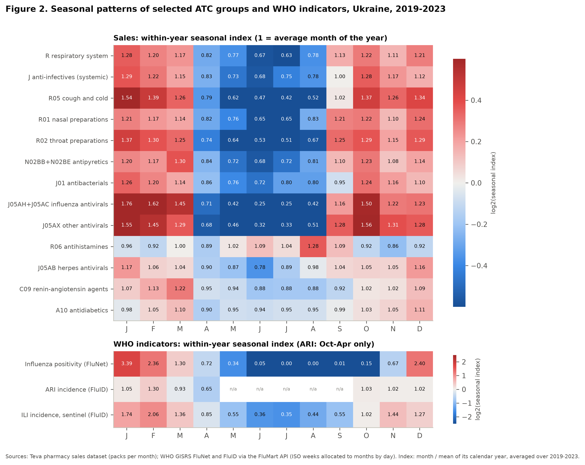
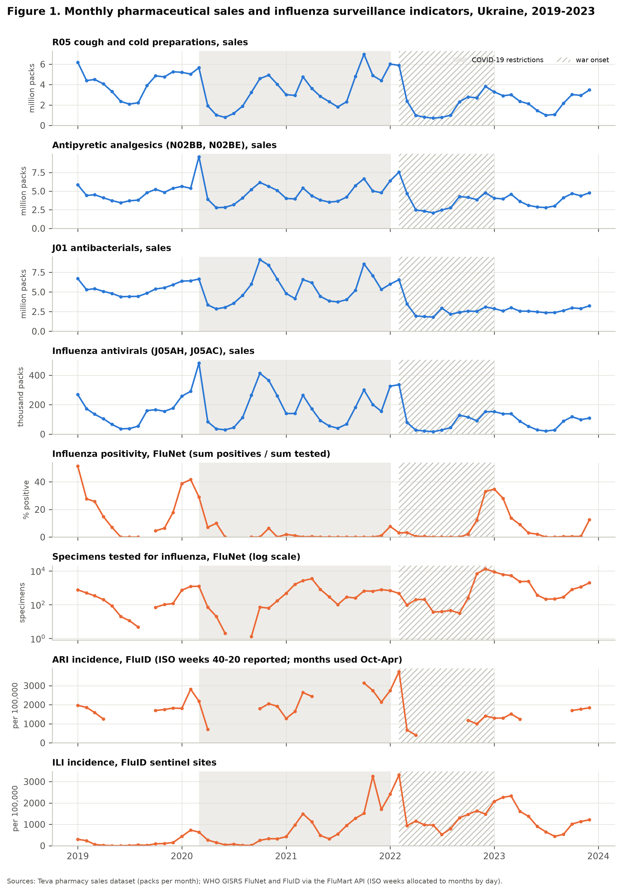
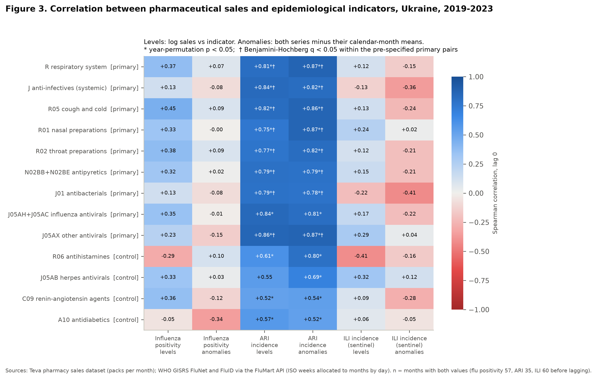
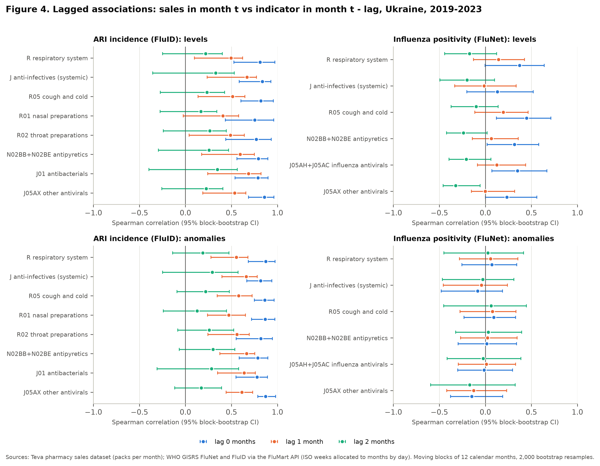

# Seasonality of Pharmaceutical Sales and WHO Respiratory Surveillance: Epidemiological Validation

This report documents an analysis that is separate from the forecasting study in `reports/report.md`. It compares the seasonality of the sales data with official WHO influenza and respiratory surveillance. It does not change any model, scenario, metric or result of the main study. Code: `scripts/analyze_who_seasonality.py`, `src/teva_forecast/who.py`, `src/teva_forecast/who_figures.py`; tests: `tests/test_who_seasonality.py`; outputs: `results/tables/who_*.csv`, `results/figures/who_*.png`.

## Summary

* **Geography.** The dataset documentation does not name the market. Its aggregate volumes reproduce, to within 0.08%, the figures that Proxima Research publishes for retail pharmacy sales of medicines in Ukraine (government-controlled territory, excluding Crimea and the former JFO zone). This holds for every year 2019–2023 and for individual months, including the war shock of 2022. The comparison therefore uses WHO surveillance data for Ukraine. The identification is our inference from verifiable sources, not a statement of the data providers.
* **Seasonal timing agrees.** Respiratory and systemic anti-infective sales peak between October and March and reach their low in June–August. This is the season of acute respiratory infections (ARI) in the WHO data. Sales rise already in September–October, about two months before influenza activity, which is concentrated in December–February.
* **ARI: strong association, but not specific in the pre-specified analysis.**
  * All eight pre-specified ARI pairs correlate strongly with ARI incidence: Spearman ρ = 0.75–0.86, lag 0, 35 in-season months, Benjamini–Hochberg q < 0.001. Influenza antivirals, pre-specified for influenza only, also correlate (ρ = 0.84).
  * The negative controls correlate too (ρ = 0.52–0.61 in levels, 0.52–0.80 in anomalies), and most of them also pass the year-permutation test: p = 0.017–0.067 in levels, 0.008–0.042 in anomalies. The pre-specified analysis therefore does not separate the respiratory and anti-infective groups from the controls. Shocks that moved pharmacy sales and ARI notifications in the same months, above all the 2022 war onset, are a likely contributor. Without the war-onset months most of these correlations fall (primary 0.61–0.82, controls 0.40–0.59), but the controls still reach 0.25–0.51 when both anomalous periods are removed.
* **Post hoc, exploratory: demand relative to chronic medicines.** Each group's sales were divided by the sales of a chronic-treatment basket (C09 + A10).
  * Relative demand of the primary groups keeps ρ = 0.58–0.82 with ARI (permutation p ≤ 0.025), except nasal preparations (0.37, p = 0.12).
  * Herpes antivirals lose the association (ρ = −0.01). Antihistamines lose it in levels (0.19, p = 0.40) but keep it in anomalies (0.43, p = 0.025).
  * The basket has its own seasonality and its own reaction to the shocks, so the ratio does not isolate infection-driven demand.
* **Influenza: no detectable association beyond shared seasonality, with low power.** Correlations with influenza positivity are moderate in levels (ρ = 0.13–0.45 for the pre-specified pairs). The year-permutation test gives p = 0.47–0.97, and deseasonalized anomalies give ρ = −0.15 to 0.09. Five seasons, one of them almost without influenza and the largest coinciding with the war, give the test little power.
* **Timing.** Among the pre-specified lags (indicator simultaneous or leading by 1–2 months), ARI correlations are highest at lag 0, also when compared on a common set of months. In an exploratory analysis, sales leading influenza by 1–2 months correlate slightly more than at lag 0, consistent with the sales season starting earlier, and still show nothing beyond seasonality.
* **These are statistical associations of aggregate time series.** They do not show that infections cause purchases. They rest on few independent observations: effective sample size about 17–28 months for ARI, 12–20 for influenza positivity and 8–16 for ILI. The WHO series have changing surveillance, and the period is dominated by the COVID-19 pandemic and the war.

## 1. Seasonality in the sales data

**How the seasonal index is computed** (same definition as `src/teva_forecast/eda.py::seasonal_index`, reimplemented for single series with missing months in `who.py::seasonal_index`). For a group, monthly packs are divided by the mean of their calendar year, and the ratios are averaged over 2019–2023 for each calendar month. An index of 1.30 means that the month is on average 30% above the mean month of its year. Dividing by the annual mean removes differences in level between years, such as the 21% market contraction of 2022.

**Which groups are seasonal, and how stable is it?** `results/tables/who_atc1_seasonality_stability.csv` repeats the index for every year separately. Three ATC1 groups have the largest and most consistent winter excess (winter / summer ratio above 1.2 in every year), although their peak month varies between October and March:

| ATC1 group | Winter / summer ratio, mean (min–max over 5 years) | Peak month by year, 2019–2023 |
|---|---|---|
| L Antineoplastic and immunomodulating agents | 2.00 (1.37–2.86) | 1, 3, 10, 1, 10 |
| R Respiratory system | 1.83 (1.24–2.76) | 12, 3, 10, 1, 12 |
| J Anti-infectives for systemic use | 1.68 (1.28–2.52) | 1, 10, 10, 2, 12 |

Winter = December–February, summer = June–August. The winter excess is stable, but the **peak month is not**: it moves between October and March from year to year. This is why the analysis below compares whole monthly series rather than peak dates. Most other ATC1 groups have a weaker winter excess (ratios 1.05–1.37), which reflects a general winter rise of pharmacy purchases. Dermatologicals (D) sell more in summer than in winter (ratio 0.90), with annual peaks in June or July in three of the five years. The broad winter shape of the market as a whole is important for interpreting the correlations (Section 6.5).

## 2. Geographic origin of the dataset

The task required documentary evidence. The country was not inferred from the language of the product descriptions, the presence of a `Morion ID` column, Teva office locations or the authors' e-mail addresses. The main evidence is quantitative (published market totals). Individual Morion codes found in Ukrainian price lists are used only as supporting evidence.

**What the providers state.** The case README (https://github.com/Marchev-Science/case-forecasting-pharmacutical-demand) describes the columns but names no country, market or data vendor. The slide deck shipped with the case (`img/MLapps_Teva_Pharma.pdf`, L. Tolosi-Halacheva, March 2024) plots "Teva – Morion ID … Sales Over Time" for eight product IDs and "Ambroxol total Sales Over Time" for 2021–2023. All eight IDs are ambroxol products in the dataset, and the dataset's ambroxol total has the same monthly shape. Next to these charts the slides note that the model "cannot forecast Covid and War in Ukraine". This links the data to an event in Ukraine, but it is not an explicit statement of the market.

**Independent quantitative evidence.** The dataset's monthly totals were compared with the retail pharmacy figures of the PharmXplorer audit (Proxima Research), published in the Ukrainian trade weekly *Apteka*. These figures cover the "pharmaceutical market of Ukraine" on territory controlled by the Ukrainian government (`results/tables/who_geography_evidence.csv`):

| Period | Published (million packs, medicines) | Dataset (million packs) | Source |
|---|---|---|---|
| 2019 | 1,107.5 | 1,107.3 | apteka.ua/article/581310 |
| 2020 | 1,062.9 | 1,062.9 | apteka.ua/article/655830 |
| 2021 | 1,067.7 | 1,068.1 | apteka.ua/article/684747 |
| 2022 | 844.8 (−20.9%) | 845.1 (−20.9%) | apteka.ua/article/684747 |
| 2023 | 848.7 | 848.8 | apteka.ua/article/684747 |
| Feb 2019 / Feb 2020 / Feb 2021 | 90.3 / 103.6 / 82.3 | 90.33 / 103.56 / 82.29 | apteka.ua/article/588234 |
| Feb 2022 / Feb 2023 | 109.0 / 67.4 | 109.00 / 67.44 | apteka.ua/article/660572 |
| Apr 2021 / Apr 2022 / Apr 2023 | 88.2 / 54.0 / 68.1 | 88.21 / 53.97 / 68.05 | apteka.ua/article/665965 |

All thirteen annual and monthly values agree to within 0.08% (largest deviation 0.073%), before and after the start of the war. As supporting evidence, Morion codes in Ukrainian Ministry of Health price lists republished by *Apteka* are dataset IDs of the same product (same active substance, strength and pack size). Examples from the list under MoH order No. 1041 of 1 July 2025 (apteka.ua/article/725162 [18]): 330107 azithromycin 500 mg #6, 222190 chloramphenicol 0.5 g #10, and 1555 / 63578 / 83314 fentanyl patches 25 / 50 / 75 µg/h #5. This check is not independent of the first: Morion codes, the Proxima Research audit and *Apteka* come from the same Ukrainian group of companies.

**Decision.** *Supported by converging documentary evidence, not stated by the providers.* The dataset is very likely the Ukrainian retail pharmacy market for medicines as measured by Proxima Research, despite its file name. The country rests on the match with one vendor's published totals and that vendor's product codes. The vendor, the territorial definition and the extraction date are not confirmed by the providers, and a written confirmation from them would settle it. Of the 13 values, 6 were checked again by hand on 2026-10-26: the annual 2021–2023 values (article 684747) and the April values (article 665965). The other 7 were checked only by the automated evidence search on the same day (column `check` of the evidence table).

**Consequence for the comparison.** WHO surveillance data for **Ukraine** are used. The published market figures cover government-controlled territory, which shrank in 2022. The WHO data do not document which territory the ARI population covered refers to; that population was 37.8 million in 2021/22, 41.0 million in 2022/23 and 36.0 million in 2023/24. Territorial changes in either series cannot be separated from true changes in demand or morbidity.

## 3. WHO surveillance data

All data were downloaded from the WHO FluMart OData API, which serves the public FluNet and FluID datasets of the Global Influenza Surveillance and Response System (GISRS). Download time 2026-10-25 20:24 UTC; file checksums in `results/tables/who_provenance.csv`.

| Dataset | API view and query | Portal | Content used |
|---|---|---|---|
| FluNet | `VIW_FNT`, `COUNTRY_CODE eq 'UKR'` | https://www.who.int/tools/flunet | weekly specimens processed for influenza (`SPEC_PROCESSED_NB`), influenza detections (`INF_ALL`), RSV specimens and detections; by site type (sentinel / non-sentinel) |
| FluID | `VIW_FID_EPI`, `COUNTRY_CODE eq 'UKR'` | https://www.who.int/teams/global-influenza-programme/surveillance-and-monitoring/influenza-surveillance-outputs | weekly ILI cases and population covered, ARI cases and population covered, SARI cases and inpatients, by age group |
| Field definitions | `VIW_FLU_METADATA` | https://xmart-api-public.who.int/FLUMART | official field descriptions |

**Indicators and availability, 2019–2023** (`results/tables/who_indicator_availability.csv`):

| Indicator | Definition used | Months available | Main caveats |
|---|---|---|---|
| Influenza positivity | Σ influenza detections / Σ specimens tested per month (sentinel + non-sentinel) | 57 of 60 | Testing volume grew 13-fold (2,185 specimens in 2019, 29,499 in 2023). No specimens in 2019-09, 2020-07 and 2020-08. Almost no influenza circulated in 2020/21 (51 positives in 2021) |
| ARI incidence | ARI cases per 100,000 population covered per month (all ages; population covered 36.0–42.2 million) | 35 (October–April of each year) | Reported in ISO weeks 40–20 only. Weeks 21–39 are filled with zeros, which are treated as missing. May falls below the coverage threshold, so the months used are October–April. Population covered: 37.8 million in 2021/22, 41.0 million in 2022/23, 36.0 million from October 2023 |
| ILI incidence | ILI cases per 100,000 population covered at sentinel sites | 60 | Small sentinel network (36,900–70,300 population covered). Its rates rise sharply from 2021, when COVID-19 is captured by the ILI definition and the network expands |
| SARI share | SARI cases per 100 inpatients | 54 | 60%+ in 2021 (COVID-19) and a changed denominator from 2022: not comparable over time, so not used for correlations |
| RSV positivity | RSV detections / RSV specimens | 24 (from 2021) | Testing volumes vary by a factor of over 1,000 between months. Detections reported without RSV specimens (three non-sentinel weeks of February 2021) are dropped. Not used for correlations |

The number of positive specimens is never used as a measure of the number of cases. Only positivity (a ratio) and population-based incidence rates enter the analysis.

**Terms of use and redistribution.** WHO's terms for its published datasets allow use and distribution for public health purposes with attribution to WHO and the countries providing the data, and exclude commercial promotion (https://www.who.int/about/policies/publishing/data-policy/terms-and-conditions). The raw WHO files are therefore not committed. `scripts/analyze_who_seasonality.py` downloads them to `data/raw/who/` (git-ignored) and records URL, time and SHA-256. Only derived monthly aggregates (`results/tables/who_monthly_series.csv`) are included, with this attribution: *WHO, FluNet and FluID (Global Influenza Surveillance and Response System), 2026, accessed 25 October 2026; data provided by the national influenza surveillance of Ukraine.*

## 4. Mapping of ATC groups to indicators

The groups, the indicators and the pairs counted as "primary" are fixed in the pre-specified block of `scripts/analyze_who_seasonality.py` (`results/tables/who_atc_indicator_mapping_groups.csv`). The plan was not committed separately before the analysis, so its timing relative to the first results cannot be checked independently. Besides the whole ATC1 groups R and J, narrower infection-related subgroups are analysed; allergy (R06) and herpes antivirals (J05AB) serve as controls.

| Group | ATC codes | Role | Linked indicators (primary pairs) | Rationale |
|---|---|---|---|---|
| R respiratory system | ATC1 R | primary | ARI, influenza | requested ATC1 group; includes R03 asthma and R06 allergy, so only partly infection-related |
| J anti-infectives | ATC1 J | primary | ARI, influenza | requested ATC1 group; includes antifungals, vaccines, antiretrovirals |
| Cough and cold | R05 | primary | ARI, influenza | symptomatic treatment of acute respiratory infections |
| Nasal preparations | R01 | primary | ARI | decongestants for upper respiratory infections (also allergic rhinitis) |
| Throat preparations | R02 | primary | ARI | sore throat in upper respiratory infections |
| Antipyretic analgesics | N02BB, N02BE (metamizole, paracetamol) | primary | ARI, influenza | fever and pain; salicylates (N02BA) are excluded because of low-dose aspirin for cardiovascular prophylaxis |
| Antibacterials | J01 | primary | ARI | respiratory infections are a main driver of outpatient antibiotic use, including inappropriate use for viral infections |
| Influenza antivirals | J05AH, J05AC (oseltamivir, rimantadine) | primary | influenza | influenza-specific |
| Other antivirals | J05AX (packs 2019–2023: inosine pranobex 40%, tilorone 24%, enisamium 13%, a Calamagrostis/Deschampsia preparation 7%, umifenovir 4%) | primary | ARI, influenza | marketed for acute respiratory viral infections |
| Antihistamines | R06 | control | – | seasonal but non-infectious (pollen allergy; peak in August) |
| Herpes antivirals | J05AB | control | – | anti-infective without a respiratory link |
| Renin–angiotensin agents | C09 | control | – | chronic treatment |
| Antidiabetics | A10 | control | – | chronic treatment |

ILI was analysed for all groups as a secondary indicator because of the surveillance changes described above.

## 5. Methods

**Weekly to monthly.** WHO data are ISO weeks (Monday–Sunday). Each week contributes one seventh of each count to each of its seven days, and days are summed by calendar month, so a week crossing a month boundary is split proportionally (ISO week 53 is handled the same way). Influenza positivity of a month is the ratio of the allocated sums, Σ positives / Σ specimens, not the mean of weekly percentages; detections reported in a row without specimens tested are dropped. Incidence is the allocated cases divided by the day-weighted mean population covered, scaled to the whole month when some days are unreported. Months with less than 75% of their days reported are set to missing. Sales are calendar-month totals of packs over all SKUs whose ATC code starts with the listed prefixes.

**Unit tests** (`tests/test_who_seasonality.py`, 19 tests) check:
* conservation of totals, boundary weeks and week 53;
* ratio-of-sums positivity and the RSV denominator;
* the all-ages construction of FluID: the all-ages row is labelled inconsistently as `ALL`/`All`, and the four standard age groups are summed when that row is missing or zero;
* the treatment of zero ARI weeks;
* lag alignment, including masking of both the sales month and the indicator month;
* the permutation test with excluded months, the gap-aware autocorrelation and the other statistical helpers.

**Series compared.** *Levels:* log sales against the indicator (influenza positivity untransformed; ARI and ILI log-transformed). *Anomalies:* both series minus their calendar-month means (log scale for sales, ARI and ILI). The means are computed over the months kept in each analysis period. This removes the seasonal shape that every group shares and tests whether year-to-year deviations move together.

**Correlation and lags.** Pearson and Spearman correlations of sales in month *t* with the indicator in month *t − k*, k = 0, 1, 2 (indicator simultaneous or leading). Lag 0 was the a-priori expectation, because pharmacy purchases and surveillance notifications both occur around symptom onset. All three lags are reported, and no lag was chosen by its result. In the sensitivity analyses a pair enters only if both the sales month *t* and the indicator month *t − k* lie outside the excluded windows.

**Inference under autocorrelation.** Monthly series are autocorrelated, and five years contain only five independent seasonal cycles, so ordinary p-values are invalid. Three complementary measures are reported for every correlation:

1. **Effective sample size** from lag-1 autocorrelations (Bretherton et al., 1999), with the corresponding t-test p-value. The autocorrelations use only pairs of adjacent calendar months, so months on either side of a gap (for example, ARI April and October) are not treated as neighbours.
2. **95% moving-block bootstrap interval** with blocks of 12 consecutive calendar months and 2,000 resamples. Gaps are resampled together with their neighbours. Resamples with fewer than 8 pairs are skipped, and no interval is reported if fewer than 80% of resamples are usable.
3. **Exact year-permutation test.**
   * Whole calendar years of the indicator are permuted (5! = 120 arrangements), keeping each year's seasonal shape. Excluded months, the lag and the calendar-month means of the anomalies are applied at fixed calendar positions after each permutation, so every arrangement is evaluated by the same rule.
   * The test asks whether the true alignment of years gives a stronger correlation than misaligned years. It removes the shared within-year seasonal shape. Any year-level variation common to both series still counts against the null, epidemic or not: COVID-19 lockdowns, the war onset, changes of territory or of surveillance. It is therefore a test of year alignment, not of an epidemic-specific link. The negative controls show this in practice (Section 6.3).
   * In the sensitivity periods the permuted indicator years also bring in values from the excluded months.
   * With 120 arrangements the smallest attainable p-value is 1/120 ≈ 0.008. 76 of the 120 arrangements keep at least one year in place, which makes the test conservative and its power low.

Benjamini–Hochberg q-values are computed from the effective-sample-size p-values within the pre-specified family: primary pairs, lag 0, full period. The family has 14 pairs per series type: 8 with ARI and 6 with influenza positivity. Influenza antivirals were pre-specified for influenza only, so their correlation with ARI is outside the family.

**Robustness to the anomalous periods.** All correlations were recomputed (a) without March 2020 – December 2021 (COVID-19 restrictions, when influenza almost disappeared), (b) without February–December 2022 (full-scale invasion), and (c) without both.

**Common seasonality and market-wide shocks.**
* Negative-control groups (C09, A10, J05AB, R06) were analysed exactly like the primary groups.
* A **post hoc** check, which was not pre-specified, divides each group's sales by the sales of a chronic-treatment basket (C09 + A10) before correlating (`who_correlations_relative_to_chronic.csv`). It was added after the controls were seen to correlate with ARI. It was meant to remove market-wide movements but does so only partly. The basket has its own seasonality (index 1.19 in March, 0.89–0.90 in June–August), and it reacted to the shocks differently from acute medicines: it rose at the war onset while acute purchases collapsed.

**Exploratory additions** (`who_correlations_exploratory.csv`), made after the first results and not used for the conclusions on the pre-specified plan:
* sales leading the indicator (k = −1, −2);
* all lags from −2 to 2 on a common set of months, the months for which the indicator exists at every lag;
* antibiotic groups (J01, J) without the period after 1 August 2022, when dispensing of antibiotics by electronic prescription began [17].

## 6. Results

### 6.1 Seasonal patterns (Figure 2)



*Figure 2. Within-year seasonal index of sales by ATC group (top) and of WHO indicators (bottom), Ukraine, 2019–2023. Index = month / mean of its calendar year, averaged over five years; colour on a log2 scale. ARI is reported only in ISO weeks 40–20, and only October–April months pass the coverage threshold, so its index is relative to the in-season mean. Sources: sales dataset (packs); WHO FluNet and FluID (accessed 25 Oct 2026); n = 60 months (influenza positivity 57, ARI 35). Table: `who_seasonal_profiles.csv`.*

* Sales of the primary groups peak between October and March and reach their low in June–August. Most peak in January (R05 1.54 vs 0.42 in July; influenza antivirals 1.76 vs 0.25 in June–July). Antipyretics peak in March (1.30, partly the panic buying of March 2020), and J05AX in October (1.56 vs 0.32 in June).
* Influenza positivity is concentrated in December–February (index 2.40, 3.39 and 2.36) and is near zero from June to October.
* ILI peaks in February (2.06) and is lowest in summer (0.35 in July).
* Sales rise already in September–October (R01 1.21–1.22, R02 1.25–1.29, J05AX 1.28–1.56), when influenza positivity is still near zero (index 0.01–0.15). This fits the broader season of acute respiratory infections (school year, rhinoviruses, and SARS-CoV-2 in 2020–2021) rather than influenza alone.
* Controls behave differently. Antihistamines peak in August (1.28, pollen season). Antidiabetics vary only between 0.90 and 1.11. Renin–angiotensin agents have a mild late-winter maximum (1.22 in March), part of the general winter rise of pharmacy purchases. The chronic basket used in the post hoc check (C09 + A10) has an index of 1.19 in March and 0.89–0.90 in June–August.

### 6.2 Monthly dynamics (Figure 1)



*Figure 1. Monthly sales of four respiratory and anti-infective groups (blue) and WHO indicators (orange), Ukraine, 2019–2023. Shaded: COVID-19 restrictions (March 2020 – December 2021); hatched: war onset (February–December 2022). Influenza positivity is Σ positives / Σ specimens per month; specimens are on a log scale; ARI and ILI are cases per 100,000 per month. Sources as in Figure 2; n = 60 months (influenza positivity 57, ARI 35). Table: `who_monthly_series.csv`.*

* **Shocks shared by sales and surveillance.** Total pharmacy sales rose by 15% in March 2020 (panic buying) and collapsed in March–April 2022. Both shocks appear in every respiratory and anti-infective series. The chronic controls behaved differently at the war onset: C09 and A10 stayed above their usual March level in March 2022 and fell only in April. ARI notifications fell from February to April 2020 (2,814, 2,187 and 709 per 100,000) and again in March–April 2022.
* **COVID-19 waves without influenza.** R05 and J01 reach their period maxima in October 2021 (7.0 million packs) and October 2020 (9.1 million), while influenza positivity is near zero. Antipyretics and antivirals also have high autumn values but peak elsewhere: antipyretics and influenza antivirals in March 2020 (panic buying), J05AX in January–February 2022. ILI captures the COVID-19 waves.
* **The 2022/23 influenza season** (positivity up to 35%) shows only moderate sales peaks, on a market about 21% smaller after the start of the war.
* **Antibiotics after August 2022.** J01 sales in August–December fell from 4.0–9.1 million packs a month in 2019–2021 to 2.2–3.2 million in 2022–2023, a fall of 56% in the August–December mean. Over the same months renin–angiotensin agents fell by 13% and antidiabetics by 16%. The fall coincides with the start of antibiotic dispensing by electronic prescription on 1 August 2022 [17].

### 6.3 Correlations at lag 0 (Figure 3, Table)



*Figure 3. Spearman correlation between monthly sales and WHO indicators, lag 0, full period 2019–2023. Levels: log sales vs indicator; anomalies: deviations from calendar-month means. \* exact year-permutation p < 0.05 (120 permutations; minimum attainable 0.008); † Benjamini–Hochberg q < 0.05 within the pre-specified primary pairs. n = 57 (influenza positivity), 35 (ARI), 60 (ILI). Table: `who_correlations.csv`.*

**Main results, pre-specified analysis** (`results/tables/who_summary_table.csv`; Spearman ρ, lag 0, full period; 95% block-bootstrap CI; p = year-permutation p, 120 permutations, minimum 0.008):

| Group | Role | Pre-specified pairs | ARI levels ρ [95% CI] (p) | ARI anomalies ρ (p) | Influenza levels ρ (p) | Influenza anomalies ρ (p) |
|---|---|---|---|---|---|---|
| R respiratory system | primary | ARI, influenza | 0.81 [0.53, 0.97] (0.008) | 0.87 (0.008) | 0.37 (0.508) | 0.07 (0.683) |
| J anti-infectives | primary | ARI, influenza | 0.84 [0.59, 0.93] (0.008) | 0.82 (0.008) | 0.13 (0.817) | −0.08 (0.767) |
| R05 cough and cold | primary | ARI, influenza | 0.82 [0.60, 0.95] (0.008) | 0.86 (0.008) | 0.45 (0.467) | 0.09 (0.608) |
| R01 nasal preparations | primary | ARI | 0.75 [0.43, 0.96] (0.008) | 0.87 (0.008) | 0.33 (0.533) | 0.00 (0.992) |
| R02 throat preparations | primary | ARI | 0.77 [0.44, 0.93] (0.008) | 0.82 (0.008) | 0.38 (0.450) | 0.09 (0.575) |
| N02BB+N02BE antipyretics | primary | ARI, influenza | 0.79 [0.56, 0.90] (0.008) | 0.79 (0.008) | 0.32 (0.567) | 0.02 (0.908) |
| J01 antibacterials | primary | ARI | 0.79 [0.54, 0.90] (0.008) | 0.78 (0.008) | 0.13 (0.767) | −0.08 (0.800) |
| J05AH+J05AC influenza antivirals | primary | influenza | 0.84 [0.60, 0.96] (0.008) | 0.81 (0.008) | 0.35 (0.692) | −0.01 (0.967) |
| J05AX other antivirals | primary | ARI, influenza | 0.86 [0.69, 0.96] (0.008) | 0.87 (0.008) | 0.23 (0.967) | −0.15 (0.367) |
| R06 antihistamines | control | – | 0.61 [0.37, 0.90] (0.025) | 0.80 (0.008) | −0.29 (0.625) | 0.10 (0.500) |
| J05AB herpes antivirals | control | – | 0.55 [0.29, 0.86] (0.067) | 0.69 (0.042) | 0.33 (0.467) | 0.03 (0.867) |
| C09 renin–angiotensin agents | control | – | 0.52 [0.18, 0.75] (0.017) | 0.54 (0.033) | 0.36 (0.867) | −0.12 (0.467) |
| A10 antidiabetics | control | – | 0.57 [0.38, 0.88] (0.017) | 0.52 (0.017) | −0.05 (0.817) | −0.34 (0.225) |

* **ARI, primary groups.** The eight pre-specified ARI pairs correlate strongly in levels (ρ = 0.75–0.86) and in anomalies (0.78–0.87). Their year-permutation p is at the minimum of 0.008, effective sample size 18–28, and BH q < 0.001. Influenza antivirals are outside the BH family for ARI and correlate similarly (0.84).
* **ARI, negative controls.** The controls correlate in levels (0.52–0.61) and anomalies (0.52–0.80), with permutation p = 0.017–0.067 and 0.008–0.042. With 120 permutations, 0.008 and 0.017 differ by a single arrangement. The year-permutation test detects any shared year-level variation, so these results do not show an epidemic-specific link for either group.
* **Influenza positivity.** For the pre-specified pairs, correlations in levels are moderate (0.13–0.45). The year-permutation test (p = 0.47–0.97) and the anomalies (ρ = −0.15 to 0.09; BH q ≥ 0.86) show no detectable association beyond the shared seasonal shape.
* **ILI.** Correlations are weak or negative. For the primary groups they range from −0.22 to 0.29 in levels and from −0.41 to 0.04 in anomalies; across all groups the levels range is −0.41 to 0.32. This is consistent with the structural break of the sentinel series in 2021.

### 6.4 Lagged associations (Figure 4)



*Figure 4. Spearman correlation of sales in month t with the indicator in month t − lag (lag 0, 1, 2 months) for the pre-specified primary pairs, levels (top) and anomalies (bottom), with 95% moving-block bootstrap intervals (blocks of 12 calendar months, 2,000 resamples). Full period 2019–2023; n as in Figure 3 minus the lag. Table: `who_correlations.csv`.*

* **ARI.** The correlations decrease with the lag. R05 has 0.82, 0.51 and 0.23 at lags 0, 1 and 2 months, and J01 0.79, 0.69 and 0.35. The lags use different calendar months, though: at lag 0 the sales months are October–April, at lag 2 December–June. Restricting all lags from −2 to 2 to the months where ARI exists at every lag (December–February, n = 12; exploratory) gives the same result: lag 0 is the highest for every primary group (0.78–0.92), and sales leading ARI by 1–2 months gives lower values (−0.41 to 0.34).
* **Influenza positivity.** The level correlations fall from lag 0 to lag 2 (R05: 0.45, 0.20, −0.10). In the exploratory analysis, sales leading influenza by 1–2 months give slightly higher level correlations than lag 0 (R05 0.50 at both; antipyretics 0.43 and 0.48 vs 0.32; influenza antivirals 0.44 and 0.47 vs 0.35). This fits sales rising before the influenza season. The permutation p-values at these lags (0.68–0.99 for the six pre-specified influenza pairs) again show nothing beyond seasonality. Anomaly correlations stay between −0.29 and 0.09 at every lag from −2 to 2.

At monthly resolution the data show no delay between ARI notifications and sales.

### 6.5 Robustness, common seasonality and market-wide shocks

**Excluding the anomalous periods.** Results below are lag 0, levels, Spearman ρ with year-permutation p for the eight pre-specified ARI pairs. Bootstrap intervals are not used here, because with so few months they are unstable.

| Period | n | Primary groups ρ (p) | Controls ρ (p) |
|---|---|---|---|
| Full period | 35 | 0.75–0.86 (0.008) | 0.52–0.61 (0.017–0.067) |
| Without COVID-19 restrictions | 23 | 0.78–0.86 (0.008–0.025) | 0.37–0.66 (0.058–0.27) |
| Without the war onset | 29 | 0.61–0.82 (0.008) | 0.40–0.59 (0.017–0.18) |
| Without both | 17 | 0.61–0.78 (0.008–0.033) | 0.25–0.51 (0.12–0.48) |

* In the sensitivity periods the permuted indicator years also bring in values from the excluded months (Section 5).
* In anomalies, without both periods, the primary correlations drop to 0.35–0.56 (p = 0.058–0.38), and the controls to −0.05–0.27. The year-to-year co-movement therefore rests to a large extent on the anomalous periods.
* For influenza positivity, removing the COVID period raises the primary level correlations to 0.55–0.76. Influenza antivirals reach 0.73 with p = 0.008, but this pair is outside any correction and its anomaly correlation is 0.16 (p = 0.34). The renin–angiotensin control rises too (0.64, p = 0.083), and the primary anomaly correlations stay at or below 0.25 (n = 37).
* **Antibiotics without the e-prescription period** (August 2022 onward excluded; exploratory). J01 keeps its ARI association (levels 0.72, p = 0.008; anomalies 0.79, p = 0.017; n = 25) and still shows none with influenza (levels 0.24, p = 0.76; n = 40).

**Controls and shared shocks.** The controls correlate with ARI less strongly than the primary groups but clearly (levels 0.52–0.61 against 0.75–0.86), and in anomalies antihistamines reach 0.80. Compared with their usual level for the calendar month, sales and ARI notifications moved together in the shock months. Both were high in March 2020 (log anomaly: R05 +0.38, ARI +0.33, although ARI fell from its February level) and in February 2022 (+0.37 and +0.57). Both were low in April 2020 (−0.19 and −0.36) and in March–April 2022 (down to −0.85 and −0.92). Such months contribute to the correlations of all groups. The data cannot tell whether the two series moved for related or unrelated reasons.

**Post hoc, exploratory: demand relative to the chronic-treatment basket** (sales / (C09 + A10); `who_correlations_relative_to_chronic.csv`; ARI, lag 0, Spearman ρ with year-permutation p):

| Group | Role | Levels, full period | Anomalies, full period | Levels, without war onset | Levels, without both periods |
|---|---|---|---|---|---|
| R respiratory system | primary | 0.60 (0.025) | 0.77 (0.008) | 0.47 (0.025) | 0.52 (0.050) |
| J anti-infectives | primary | 0.78 (0.008) | 0.76 (0.008) | 0.73 (0.008) | 0.66 (0.017) |
| R05 cough and cold | primary | 0.72 (0.008) | 0.79 (0.008) | 0.64 (0.008) | 0.59 (0.025) |
| R01 nasal preparations | primary | 0.37 (0.117) | 0.60 (0.008) | 0.30 (0.192) | 0.38 (0.025) |
| R02 throat preparations | primary | 0.65 (0.017) | 0.75 (0.008) | 0.53 (0.025) | 0.61 (0.025) |
| N02BB+N02BE antipyretics | primary | 0.58 (0.008) | 0.66 (0.008) | 0.52 (0.008) | 0.66 (0.008) |
| J01 antibacterials | primary | 0.73 (0.008) | 0.72 (0.008) | 0.68 (0.008) | 0.65 (0.017) |
| J05AH+J05AC influenza antivirals | primary | 0.78 (0.008) | 0.76 (0.008) | 0.71 (0.008) | 0.60 (0.058) |
| J05AX other antivirals | primary | 0.82 (0.008) | 0.82 (0.008) | 0.81 (0.008) | 0.68 (0.008) |
| R06 antihistamines | control | 0.19 (0.400) | 0.43 (0.025) | −0.02 (0.942) | 0.02 (0.925) |
| J05AB herpes antivirals | control | −0.01 (0.983) | 0.17 (0.475) | −0.17 (0.550) | 0.02 (0.975) |

* In the full period the primary groups keep ρ = 0.58–0.82 in levels (p = 0.008–0.025), except nasal preparations (0.37, p = 0.12), and 0.60–0.82 in anomalies (p = 0.008).
* Herpes antivirals lose the association (levels −0.01, anomalies 0.17). Antihistamines lose it in levels (0.19, p = 0.40) but not in anomalies (0.43, p = 0.025), so not every control loses its association.
* The basket does not cancel the shocks. At the war onset its log anomaly was +0.23 in February and +0.11 in March 2022, while R05's was +0.37 and −0.48. The ratio therefore keeps, and in March 2022 amplifies, the collapse in acute purchases: the log anomaly of R05 / basket was −0.59, against −0.84 for ARI.
* Without the war onset, the primary groups keep 0.30–0.81 (p ≤ 0.025 except nasal preparations, 0.30, p = 0.19), and the controls fall to −0.17 and −0.02. Without both periods the eight pre-specified ARI groups have 0.38–0.68 (p = 0.008–0.050; influenza antivirals 0.60, p = 0.058), the controls 0.02.
* For influenza positivity, in the full period no relative correlation of the six pre-specified pairs reaches p < 0.19 in levels or p < 0.38 in anomalies. In the sensitivity periods single pairs do (for example influenza antivirals without the COVID period: 0.71, p = 0.008), without a consistent pattern.

## 7. Interpretation

The seasonal profile of respiratory and systemic anti-infective sales in the dataset agrees in timing with WHO's respiratory surveillance for Ukraine. Monthly sales of these groups also co-vary with ARI notifications from year to year. In the pre-specified analysis, however, so do drugs without an expected epidemic link, and shocks that hit both sales and surveillance (COVID-19 restrictions, the war onset) contribute to the association.

In the post hoc analysis relative to a chronic-treatment basket, the respiratory and anti-infective groups keep an association with ARI, except nasal preparations. Herpes antivirals lose theirs, and antihistamines lose theirs in levels. This is suggestive, not conclusive: the analysis was not pre-specified, the basket reacts to the same shocks in its own way, and antihistamine anomalies remain correlated.

The co-movement with ARI is contemporaneous at monthly resolution. In the full period, influenza positivity shows no detectable association beyond the common winter shape, not even for influenza-specific antivirals. Without the COVID-19 period single pairs reach p < 0.05 (influenza antivirals in levels: 0.73, p = 0.008), outside the corrected family and without support from the anomalies. The test has little power either way.

A plausible reading, not tested causally here: pharmacy demand for these products follows the overall burden of acute respiratory illness (influenza, RSV, rhinoviruses, SARS-CoV-2), which ARI notifications measure, rather than the circulation of influenza in particular. The autumn 2020 and 2021 sales maxima of R05 and J01 without influenza support this reading. They are also consistent with self-treatment of COVID-19 symptoms and with precautionary purchasing.

**Association, not causation.** All results are correlations between aggregate monthly series. They do not show that increasing morbidity *caused* the sales. Purchasing behaviour, stockpiling, media attention, prices, supply disruptions, prescribing rules and practice can produce the same co-movement. Both series also share population and territorial changes during the war.

## 8. Limitations

1. **Geography is inferred.** The country is identified from published market statistics that reproduce the dataset's totals, and from that vendor's product codes; the data providers do not state it. If the identification were wrong, the comparison with Ukrainian surveillance would be invalid.
2. **Few independent observations.**
   * Five annual cycles and 35 in-season months for ARI.
   * Effective sample sizes of about 17–28 months (ARI), 12–20 (influenza positivity) and 8–16 (ILI).
   * A permutation test with 120 arrangements: smallest attainable p-value 0.008, and the test is conservative.
   * Wide intervals, for example R respiratory system vs ARI: 0.53–0.97.
3. **Anomalous period.** 2020–2022 is dominated by the COVID-19 pandemic (influenza almost absent in 2020/21) and by the full-scale war (market −21%, population displacement, loss of territory). The sensitivity analyses reduce the ARI sample to 17–29 months. In those periods the permutation null draws on indicator values from the excluded months, and bootstrap intervals are unstable.
4. **Surveillance changes.**
   * Influenza testing grew 13-fold.
   * ARI is reported only in ISO weeks 40–20.
   * The ARI population covered changes between seasons (37.8, 41.0 and 36.0 million in 2021/22–2023/24), and the WHO data do not document which territory it refers to.
   * The ILI network and definition effectively changed in 2021.
   * SARI and RSV series are not comparable over time.
5. **Sales are not consumption or morbidity.**
   * Sales are packs sold: a mix of prescription and over-the-counter products, panel-projected (fractional values), with stockpiling and supply effects.
   * ATC groups contain products with other indications: allergic rhinitis in R01, cardiovascular aspirin outside N02BB/N02BE, non-respiratory uses of J.
   * Dispensing of antibiotics by electronic prescription began on 1 August 2022, with paper prescriptions allowed until the end of 2022 [17]. J01 sales in August–December were 56% lower in 2022–2023 than in 2019–2021, against 13–16% for the chronic controls. This regulatory break lowers J01 and J levels in the years when ARI was also lower. J01's ARI association remains when the period after August 2022 is excluded (exploratory).
6. **Ecological, national aggregate.** Regional, age-specific and weekly variation is lost by the monthly national aggregation. The day-based allocation of weeks to months is an approximation.
7. **Low power for influenza.** Five seasons, one of them (2020/21) almost without influenza. The largest season (2022/23, positivity up to 35%) coincides with the war contraction of the market, which works against year-level alignment. The absence of a detectable association beyond seasonality is not evidence that none exists.
8. **The specificity check is post hoc.**
   * The relative-demand analysis was added after the controls were seen to correlate with ARI, and it is exploratory.
   * The chronic basket has its own seasonality (March index 1.19). It also reacted to the shocks differently: it rose at the war onset while acute purchases collapsed. So the ratio does not isolate infection-driven demand.
   * Antihistamine anomalies remain correlated with ARI after normalisation.
9. **Multiple comparisons.** The pre-specified analysis has 936 correlation rows and the post hoc analysis 176 (1,112 in total), plus 558 exploratory rows, each with Pearson and Spearman coefficients. Only the 14 pre-specified primary pairs per series type are corrected (Benjamini–Hochberg); everything else is descriptive.
10. **Pre-specification cannot be verified.** The plan is fixed in the analysis script, but it was not committed separately before the results.

## 9. Materials for the paper

**Data sources (short).** Monthly retail pharmacy sales in packs for 13,762 SKUs (2019–2023) from the public Teva/Marchev-Science case dataset, identified as the Ukrainian retail medicines market through published Proxima Research totals. Weekly influenza virological (FluNet) and epidemiological (FluID: ARI, ILI) surveillance for Ukraine from the WHO GISRS FluMart API, aggregated to calendar months.

**Method (short).**
* Pre-specified ATC groups (nine primary, four negative controls) and indicators (influenza positivity, ARI, ILI).
* Day-based allocation of ISO weeks to months, positivity as a ratio of sums, and incidence per 100,000 population covered.
* Spearman and Pearson correlations of levels and of deseasonalized anomalies at lags of 0–2 months.
* Inference by effective sample size, a moving-block bootstrap over calendar months and an exact permutation of years.
* Benjamini–Hochberg correction within the primary family.
* Sensitivity analyses without the COVID-19 and war-onset periods.
* A post hoc normalisation by a chronic-treatment basket, and exploratory sales-leading lags.

**Main results tables:** Section 6.3 (pre-specified) and Section 6.5 (post hoc). **Figures:** `results/figures/who_fig1_monthly_series.png` … `who_fig4_lagged_associations.png` (300 dpi), with captions in Section 6.

**Suggested wording.** "The seasonal pattern of respiratory and anti-infective sales is consistent in timing with WHO respiratory surveillance for Ukraine. Monthly sales of these groups were strongly associated with acute respiratory infection (ARI) notifications (Spearman ρ = 0.75–0.86). However, sales of control drugs without an expected epidemic link were associated as well (ρ = 0.52–0.61), consistent with shocks that moved the pharmacy market and surveillance in the same months. In an exploratory post hoc analysis relative to chronic-treatment sales, the respiratory and anti-infective groups remained associated with ARI (ρ = 0.58–0.82, except nasal preparations, ρ = 0.37), whereas herpes antivirals and, in levels, antihistamines did not. We found no association with influenza positivity beyond shared seasonality, although the power to detect one was low. These are statistical associations of aggregate series and do not establish that morbidity causes sales."

## 10. References

1. World Health Organization. FluNet: global influenza virological surveillance (Global Influenza Surveillance and Response System). Geneva: WHO. https://www.who.int/tools/flunet (data accessed 25 October 2026 via https://xmart-api-public.who.int/FLUMART/VIW_FNT). Data provided by the national influenza surveillance of Ukraine.
2. World Health Organization. FluID: global influenza epidemiological surveillance data (ILI, ARI, SARI). Influenza surveillance outputs, Global Influenza Programme. https://www.who.int/teams/global-influenza-programme/surveillance-and-monitoring/influenza-surveillance-outputs (data accessed 25 October 2026 via https://xmart-api-public.who.int/FLUMART/VIW_FID_EPI).
3. World Health Organization. Terms and conditions of use for WHO data compilations, aggregations, evaluations and analyses. https://www.who.int/about/policies/publishing/data-policy/terms-and-conditions (accessed 26 October 2026).
4. World Health Organization. Global epidemiological surveillance standards for influenza. Geneva: WHO; 2013.
5. Marchev-Science. Case: forecasting pharmaceutical sales (in partnership with Teva). GitHub repository. https://github.com/Marchev-Science/case-forecasting-pharmacutical-demand (accessed 26 October 2026).
6. Tolosi-Halacheva L. Machine learning applications at Teva Pharma with focus on forecasting [slides]. March 2024. Included in reference 5 as `img/MLapps_Teva_Pharma.pdf`.
7. Kirsanov D. Pharmacy sales: results of 2023 [in Ukrainian]. *Apteka* (weekly). 15 January 2024; No. 1422/1423. Data: PharmXplorer, Proxima Research. https://www.apteka.ua/article/684747 (accessed 26 October 2026).
8. Brief analysis of the pharmaceutical market: results of April 2023 [in Ukrainian]. *Apteka* (weekly). 29 May 2023; No. 1391/1392. Data: PharmXplorer, Proxima Research. https://www.apteka.ua/article/665965 (accessed 26 October 2026).
9. *Apteka* (weekly), market reviews based on Proxima Research data [in Ukrainian]: https://www.apteka.ua/article/581310 (25 January 2021), https://www.apteka.ua/article/588234 (22 March 2021), https://www.apteka.ua/article/655830 (16 January 2023), https://www.apteka.ua/article/660572 (13 March 2023) (accessed 26 October 2026).
10. Bretherton CS, Widmann M, Dymnikov VP, Wallace JM, Bladé I. The effective number of spatial degrees of freedom of a time-varying field. *Journal of Climate*. 1999;12(7):1990–2009.
11. Künsch HR. The jackknife and the bootstrap for general stationary observations. *Annals of Statistics*. 1989;17(3):1217–1241.
12. Benjamini Y, Hochberg Y. Controlling the false discovery rate: a practical and powerful approach to multiple testing. *Journal of the Royal Statistical Society: Series B*. 1995;57(1):289–300.
13. Olsen SJ, Azziz-Baumgartner E, Budd AP, et al. Decreased influenza activity during the COVID-19 pandemic — United States, Australia, Chile, and South Africa, 2020. *MMWR Morbidity and Mortality Weekly Report*. 2020;69(37):1305–1309.
14. Magruder SF. Evaluation of over-the-counter pharmaceutical sales as a possible early warning indicator of human disease. *Johns Hopkins APL Technical Digest*. 2003;24(4):349–353.
15. Das D, Metzger K, Heffernan R, Balter S, Weiss D, Mostashari F. Monitoring over-the-counter medication sales for early detection of disease outbreaks — New York City. *MMWR Supplements*. 2005;54(Suppl):41–46.
16. Vergu E, Grais RF, Sarter H, et al. Medication sales and syndromic surveillance, France. *Emerging Infectious Diseases*. 2006;12(3):416–421.
17. Ministry of Health of Ukraine. From August 2022, patients will start receiving electronic prescriptions for antibiotics [in Ukrainian]. Government portal of Ukraine, 11 July 2022. https://www.kmu.gov.ua/news/z-serpnia-2022-roku-patsiienty-pochnut-otrymuvaty-elektronni-retsepty-na-antybiotyky-moz (accessed 26 October 2026).
18. *Apteka* (online). List of declared maximum wholesale prices of medicines added to the National Price Catalogue by MoH order No. 1041 of 1 July 2025 [in Ukrainian]. https://www.apteka.ua/article/725162 (accessed 26 October 2026). See also https://www.apteka.ua/article/724441.

## 11. Reproducibility

```bash
python scripts/prepare_data.py              # processed sales panel (if not present)
python scripts/analyze_who_seasonality.py   # downloads WHO data, writes who_* tables and figures (~6 min)
python scripts/analyze_who_seasonality.py --figures-only   # redraw figures and the summary table
pytest -q tests/test_who_seasonality.py
```

The analysis reads `data/processed/` and WHO data only. It does not read or write any model, prediction or result table of the forecasting study.

